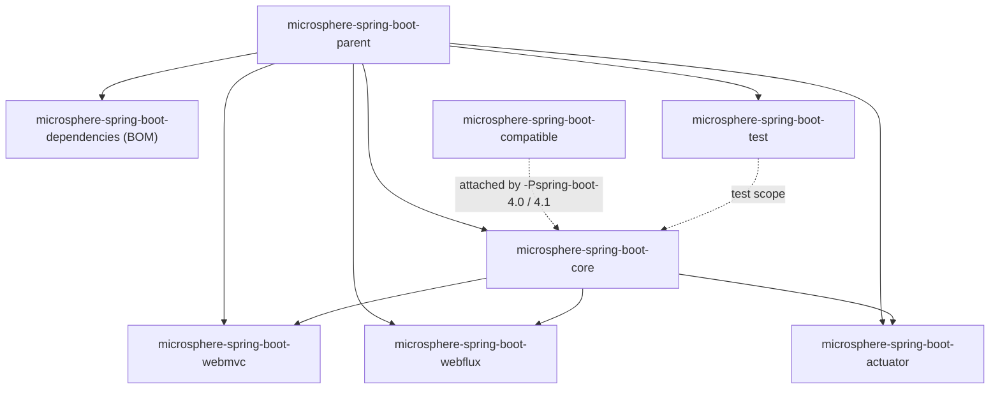

# Branch `release` (0.2.x) Overview

> [中文](./zh/README.md) · [Documentation index](../README.md)

> **Branch:** `release` · **Version line:** `0.2.x` · **Spring Boot:** `3.0` – `4.1`
>
> Documentation for other branches: for Spring Boot 2.x see [../1.x/README.md](../1.x/README.md).

---

## 1. Version Information

| Item | Value |
|---|---|
| Group ID | `io.github.microsphere-projects` |
| Latest published release | `0.2.34` (Maven Central, 2026-08-31) |
| Branch development version | `0.2.35-SNAPSHOT` (the `<revision>` property of the root `pom.xml`) |
| Java baseline | `17` (the `<java.version>17</java.version>` property of the root `pom.xml`) |
| Maven | 3.9+; the bundled wrapper is apache-maven `3.9.16` |
| Build parent POM | `microsphere-build:0.3.16` |
| Key managed dependencies | `microsphere-spring:0.2.39` (BOM), `jolokia:2.6.3`, `junit-bom:6.1.3`, `spring-boot-dependencies:${spring-boot.version}` |
| License | Apache License 2.0 |

**Note.** The `0.2.x` line supports Spring Boot 3 and 4 only. For Spring Boot 2.x use the `0.1.x` line (see
[../1.x/README.md](../1.x/README.md)). There is no cross-generation artifact.

---

## 2. Spring Boot Compatibility

Each Maven profile pins one patch release per minor line, and CI walks every combination (JDK `17 / 21 / 25` × the 8
profiles below = 24 jobs). Other patches in the same minor line are expected to work.

| Profile | Spring Boot | Status |
|---|---|---|
| `-Pspring-boot-3.0` | `3.0.13` | Supported |
| `-Pspring-boot-3.1` | `3.1.12` | Supported |
| `-Pspring-boot-3.2` | `3.2.12` | Supported |
| `-Pspring-boot-3.3` | `3.3.13` | Supported |
| `-Pspring-boot-3.4` | `3.4.13` | Supported |
| `-Pspring-boot-3.5` | `3.5.16` | **Default** (`activeByDefault`) |
| `-Pspring-boot-4.0` | `4.0.8` | Supported; needs the `compatible` shim, see [compatible.md](./compatible.md) |
| `-Pspring-boot-4.1` | `4.1.1` | Supported; needs the `compatible` shim |

On this branch the `SpringBootVersion` enum models `SPRING_BOOT_3_0` … `SPRING_BOOT_4_1_0` plus the runtime-detected
`CURRENT` constant (see [core.md](./core.md)).

---

## 3. Module Inventory

Every module has one user document (English here, Chinese under `zh/`) and one developer document under
`../../developer-guide/current/`.

| Module | Artifact ID | In BOM | Published | User Guide | Developer Guide |
|---|---|---|---|---|---|
| Root aggregator | `microsphere-spring-boot` | — | no | [parent.md](./parent.md) | [parent.md](../../developer-guide/current/parent.md) |
| Parent POM | `microsphere-spring-boot-parent` | no | yes | [parent.md](./parent.md) · [中文](./zh/parent.md) | [parent.md](../../developer-guide/current/parent.md) |
| BOM | `microsphere-spring-boot-dependencies` | — | yes | [dependencies.md](./dependencies.md) · [中文](./zh/dependencies.md) | [dependencies.md](../../developer-guide/current/dependencies.md) |
| Core | `microsphere-spring-boot-core` | yes | yes | [core.md](./core.md) · [中文](./zh/core.md) | [core.md](../../developer-guide/current/core.md) |
| Actuator | `microsphere-spring-boot-actuator` | yes | yes | [actuator.md](./actuator.md) · [中文](./zh/actuator.md) | [actuator.md](../../developer-guide/current/actuator.md) |
| Web MVC | `microsphere-spring-boot-webmvc` | yes | yes | [webmvc.md](./webmvc.md) · [中文](./zh/webmvc.md) | [webmvc.md](../../developer-guide/current/webmvc.md) |
| WebFlux | `microsphere-spring-boot-webflux` | yes | yes | [webflux.md](./webflux.md) · [中文](./zh/webflux.md) | [webflux.md](../../developer-guide/current/webflux.md) |
| Test | `microsphere-spring-boot-test` | yes | yes | [test.md](./test.md) · [中文](./zh/test.md) | [test.md](../../developer-guide/current/test.md) |
| Compatible | `microsphere-spring-boot-compatible` | **no** | **no** (`maven-deploy-plugin` skip + `skipPublishing`) | [compatible.md](./compatible.md) · [中文](./zh/compatible.md) | [compatible.md](../../developer-guide/current/compatible.md) |

`actuator`, `webmvc` and `webflux` all depend on `core`, so depending on any of them transitively brings the core features
in.



---

## 4. Installation

### 4.1 Import the BOM

```xml

<properties>
    <microsphere-spring-boot.version>0.2.34</microsphere-spring-boot.version>
</properties>

<dependencyManagement>
    <dependencies>
        <dependency>
            <groupId>io.github.microsphere-projects</groupId>
            <artifactId>microsphere-spring-boot-dependencies</artifactId>
            <version>${microsphere-spring-boot.version}</version>
            <type>pom</type>
            <scope>import</scope>
        </dependency>
    </dependencies>
</dependencyManagement>
```

`microsphere-spring-boot-dependencies` manages exactly five artifacts — `core`, `webmvc`, `webflux`, `actuator`, `test`.
`compatible` is not managed and must not be depended on directly.

### 4.2 Add Only the Modules You Need

```xml

<dependencies>
    <!-- configuration, conditions, diagnostics -->
    <dependency>
        <groupId>io.github.microsphere-projects</groupId>
        <artifactId>microsphere-spring-boot-core</artifactId>
    </dependency>

    <!-- custom endpoints + monitored scheduler -->
    <dependency>
        <groupId>io.github.microsphere-projects</groupId>
        <artifactId>microsphere-spring-boot-actuator</artifactId>
    </dependency>

    <!-- servlet stack only -->
    <dependency>
        <groupId>io.github.microsphere-projects</groupId>
        <artifactId>microsphere-spring-boot-webmvc</artifactId>
    </dependency>

    <!-- test scope -->
    <dependency>
        <groupId>io.github.microsphere-projects</groupId>
        <artifactId>microsphere-spring-boot-test</artifactId>
        <scope>test</scope>
    </dependency>
</dependencies>
```

For reactive applications replace `webmvc` with `webflux`; both may coexist — each module's availability condition only
activates under the matching web application type.

### 4.3 Verify

```java
import io.microsphere.spring.boot.SpringBootVersion;
import org.springframework.boot.SpringApplication;
import org.springframework.boot.autoconfigure.SpringBootApplication;

@SpringBootApplication
public class MyApplication {

    public static void main(String[] args) {
        // e.g. prints: Microsphere Spring Boot 0.2.34 on Spring Boot 3.5.16
        System.out.println("Spring Boot: " + SpringBootVersion.CURRENT.getVersion());
        SpringApplication.run(MyApplication.class, args);
    }
}
```

As soon as `core` is on the classpath, `server.shutdown` becomes `graceful` — that comes from the module's own
default-properties file, not from your configuration. See [core.md](./core.md).

---

## 5. Capability Map

| Goal | Use | Docs |
|---|---|---|
| Ship overridable defaults from a library | `META-INF/config/default/*.properties` + `DefaultPropertiesPostProcessor` | [core.md](./core.md) |
| Merge auto-config exclusions from many modules | `microsphere.autoconfigure.exclude` | [core.md](./core.md) |
| Branch code by Boot version | `SpringBootVersion` | [core.md](./core.md) |
| Register a bean only when a property family exists | `@ConditionalOnPropertyPrefix` | [core.md](./core.md) |
| Observe and audit binding | `BindListener`, `ListenableBindHandlerAdapter` | [core.md](./core.md) |
| React to live property changes | `ConfigurationPropertiesBeanPropertyChangedEvent` | [core.md](./core.md) |
| Fail fast on classpath problems | banned artifacts, artifact collision + `FailureAnalyzer` | [core.md](./core.md) |
| Audit deployed JARs | `GET /actuator/microsphere/artifacts` | [actuator.md](./actuator.md) |
| One-call runtime snapshot | `GET /actuator/microsphere/web/endpoints` | [actuator.md](./actuator.md) |
| Scheduler metrics | `MonitoredThreadPoolTaskScheduler` / `actuatorTaskScheduler` | [actuator.md](./actuator.md) |
| Web stack extensions | `WebMvcAutoConfiguration`, `WebFluxAutoConfiguration` | [webmvc.md](./webmvc.md) · [webflux.md](./webflux.md) |
| Test auto-configurations | `AutoConfigurationTest` base classes | [test.md](./test.md) |

---

## 6. Building from Source

```bash
git clone https://github.com/microsphere-projects/microsphere-spring-boot.git
cd microsphere-spring-boot
git checkout release            # the branch these docs describe

./mvnw verify                   # default profile: Spring Boot 3.5.16
./mvnw verify -Pspring-boot-3.0 # another minor line
./mvnw verify -Pspring-boot-4.1 # also attaches the compatible shim module
./mvnw install -DskipTests      # install locally
```

The command shape CI uses, so you can reproduce the same matrix locally:

```bash
./mvnw --batch-mode --update-snapshots -Drevision=0.0.1-SNAPSHOT \
       -Dsurefire.useSystemClassLoader=false test \
       --activate-profiles test,coverage,spring-boot-3.5
```

---

## 7. Cross-Module FAQ

| Symptom | Answer |
|---|---|
| Want `0.2.x` on Boot 2.7 | Not possible; use `0.1.x` for Boot 2.x ([../1.x/README.md](../1.x/README.md)). |
| Did the defaults override my configuration? | No — they land in `defaultProperties`, the lowest-precedence source. |
| `compatible` missing on Maven Central | By design: unpublished, not in the BOM, attached only when building `core` under the Boot 4.x profiles. |
| Endpoint returns 404 | Check `management.endpoints.enabled-by-default=false` (the default this library sets) and `management.endpoint.<id>.enabled`, see [actuator.md](./actuator.md). |
