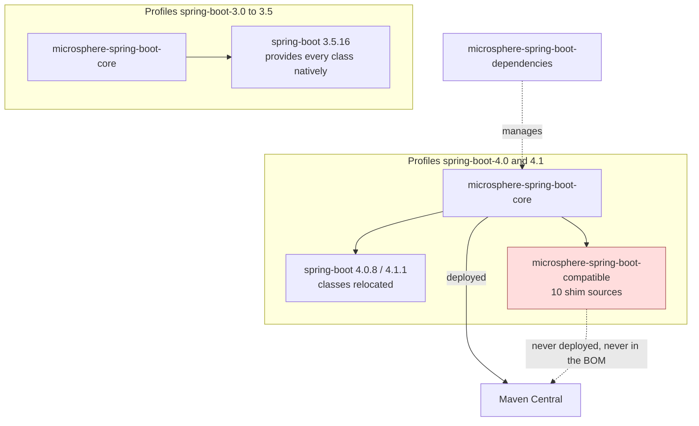

# Compatible Module (Build-Time Shims)

> [中文](./zh/compatible.md) · [Documentation index](../README.md)

> **Branch:** `release` · **Version line:** `0.2.x` · **Artifact:** `microsphere-spring-boot-compatible`
> **Spring Boot:** `4.0.8` / `4.1.1` (profiles only) · **Published:** no · **In BOM:** no · **Packaging:** jar

Contents:
[1 Module Overview](#1-module-overview) ·
[2 Version Information](#2-version-information) ·
[3 Shim Inventory](#3-shim-inventory) ·
[4 How the Module Is Attached](#4-how-the-module-is-attached) ·
[5 Alternative to Shims: By-Name References](#5-alternative-to-shims-by-name-references) ·
[6 Guidance for Application Developers](#6-guidance-for-application-developers) ·
[7 Building the Project on a Boot 4 Profile](#7-building-the-project-on-a-boot-4-profile) ·
[8 Failure Modes Without the Shims](#8-failure-modes-without-the-shims) ·
[9 FAQ](#9-faq) ·
[10 See Also](#10-see-also)

---

## 1. Module Overview

`microsphere-spring-boot-compatible` is not a library for applications. It is a **build-time shim
module**: it re-declares a small set of Spring Boot types under their original `org.springframework.boot.*`
package names so that the rest of the reactor still compiles when the active Spring Boot version has
moved or removed those types.

The module documents its own provenance in `src/main/java/org/springframework/boot/package-info.java`:

```java
/**
 * The classes in this package or sub-packages are forked from the Spring Boot 3.5.x,
 * which will be used to be compatible with the lower versions of Spring Boot.
 */
```

On this branch the shims exist because Spring Boot 4 relocated the auto-configuration property classes
and the bootstrap-context API. Without them, one source tree could not be built against both Boot 3 and
Boot 4.

| Question | Answer |
|---|---|
| Who consumes it | Only `microsphere-spring-boot-core`, and only under two profiles. |
| Who must never consume it | Your application, your libraries, and the BOM. |
| What is inside | 9 types plus one `package-info`, all under `src/main/java/org/springframework/boot/`. |

---

## 2. Version Information

| Item | Value |
|---|---|
| Coordinate | `io.github.microsphere-projects:microsphere-spring-boot-compatible` |
| Version | `${revision}`, i.e. `0.2.35-SNAPSHOT` on the branch tip |
| Published releases containing it | **None** — no `0.2.x` release ever deployed it |
| Deploy | `maven-deploy-plugin` `<skip>true</skip>` |
| Central publishing | `central-publishing-maven-plugin` `<skipPublishing>true</skipPublishing>` |
| Managed by `microsphere-spring-boot-dependencies` | No — the BOM manages `core`, `webmvc`, `webflux`, `actuator`, `test` |
| Forked from | Spring Boot `3.5.x` (this branch's default profile) |
| Profiles that attach it | `spring-boot-4.0` (`4.0.8`), `spring-boot-4.1` (`4.1.1`) |
| Profiles that ignore it | `spring-boot-3.0` … `spring-boot-3.5`, including the default `3.5.16` |
| Java | 17 baseline, same as the rest of the line |

---

## 3. Shim Inventory

| Fully-qualified type | Nested types | Introduced in Boot | Why a shim is needed here |
|---|---|---|---|
| `org.springframework.boot.BootstrapContext` | — | 2.4.0 | Bootstrap API relocated by Boot 4. |
| `org.springframework.boot.BootstrapRegistry` | `InstanceSupplier<T>`, `InstanceScope` | 2.4.0 (scope API 2.4.2) | Same. |
| `org.springframework.boot.ConfigurableBootstrapContext` | — | 2.4.0 | Same. |
| `org.springframework.boot.DefaultBootstrapContext` | — | 2.4.0 | Same. |
| `org.springframework.boot.BootstrapContextClosedEvent` | — | 2.4.0 | Same. |
| `org.springframework.boot.web.servlet.MultipartConfigFactory` | — | 1.4.0 | Relocated by Boot 4. |
| `org.springframework.boot.autoconfigure.web.ServerProperties` | — | 1.0.0 (`@ConfigurationProperties("server")`) | Property classes moved out of `autoconfigure`. |
| `org.springframework.boot.autoconfigure.web.servlet.MultipartProperties` | — | 2.0.0 (`spring.servlet.multipart`) | Same. |
| `org.springframework.boot.autoconfigure.jackson.JacksonProperties` | — | 1.2.0 (`spring.jackson`) | Same. |
| `org.springframework.boot.package-info` | — | 1.0.0 | Records the fork source and intent. |

Two details that matter when you read a shim:

* The bootstrap types are the Boot 2.4-era API surface — `get`, `getOrElse`, `getOrElseSupply`,
  `getOrElseThrow`, `isRegistered` — which `core`'s `SpringApplicationRunListener` adapter calls.
* The property classes are functional `@ConfigurationProperties` beans, not empty stubs: `core`'s tests
  bind real values through them, so a shim has to carry the same accessors.

Because these fully-qualified names are identical to Spring Boot's own, the shim classes would be
**duplicate classes** on a Boot 3 classpath. That is precisely why the module is never published and
never reaches a runtime classpath outside this reactor.

### Difference on the `1.x` line

On `release-1.x` the same module carries **12** files with a different rationale: the five bootstrap types
plus `actuate.endpoint.EndpointId`, `context.properties.ConstructorBinding`, the endpoint availability
condition trio (`AbstractEndpointCondition`, `ConditionalOnAvailableEndpoint`, `OnAvailableEndpointCondition`)
and `actuate.autoconfigure.endpoint.expose.IncludeExcludeEndpointFilter` — attached by profiles
`spring-boot-2.1`, `spring-boot-2.2`, `spring-boot-2.3` instead. See
[../1.x/compatible.md](../1.x/compatible.md).

---

## 4. How the Module Is Attached

`microsphere-spring-boot-core/pom.xml` adds it inside two profiles (lines 97–121):

```xml
<profiles>
    <profile>
        <id>spring-boot-4.0</id>
        <dependencies>
            <dependency>
                <groupId>io.github.microsphere-projects</groupId>
                <artifactId>microsphere-spring-boot-compatible</artifactId>
                <version>${revision}</version>
            </dependency>
        </dependencies>
    </profile>

    <profile>
        <id>spring-boot-4.1</id>
        <dependencies>
            <!-- the same dependency as the block above -->
        </dependencies>
    </profile>
</profiles>
```

`actuator`, `webmvc`, `webflux` and `test` do **not** reference it. In the root POM's `<modules>` order,
`compatible` is listed before `core`, so a Boot 4 profile build compiles the shims first and `core` then
resolves them from the local reactor.



---

## 5. Alternative to Shims: By-Name References

A shim is the heavier tool. Where a class merely *changed package* and is only referenced as a string in
a condition annotation, this project avoids the fork and lists both names instead:

| Mechanism | Use when | Example in this project |
|---|---|---|
| By-name condition attributes | The class is referenced only by name, and both names can be listed. | `@AutoConfigureAfter(name = { ... })` in `webmvc` / `webflux`; see [webmvc.md](./webmvc.md). |
| `compatible` shim | The class appears in an `import`, `extends`, annotation type, or binding code path and must exist at compile time. | `ConfigurableBootstrapContext`, `ServerProperties`, `JacksonProperties`, `MultipartProperties`. |

---

## 6. Guidance for Application Developers

1. **Do not add this artifact to your POM.** It is not published, so resolution fails with
   `Could not find artifact io.github.microsphere-projects:microsphere-spring-boot-compatible`.
2. **Do not expect it in the BOM.** Its absence is deliberate; the BOM is a promise that everything
   listed can be downloaded.
3. **You do not need it.** Depending on `microsphere-spring-boot-core` gives you a jar that was compiled
   against the Boot line it was released for; nothing extra is required at runtime, and the shim is not
   re-exported as a transitive dependency.
4. **Do not import the shim's `org.springframework.boot.*` types in your own code.** Those package names
   belong to Spring Boot; the copies exist only inside this reactor. Use the types your application's own
   Spring Boot provides.

Two rules for contributors:

1. Keep a shim's package and class names **identical** to Spring Boot's, otherwise `core`'s imports
   cannot stay version-neutral.
2. Never add the module to the BOM or to a published module's default compile scope — attach it inside
   the profile that needs it, exactly as `core` does.

---

## 7. Building the Project on a Boot 4 Profile

```bash
# Boot 4.1.1, shims compiled in
./mvnw clean verify -Pspring-boot-4.1

# Boot 4.0.8
./mvnw clean verify -Pspring-boot-4.0

# Boot 3.5.16 (default) - the module is still built, but nothing depends on it
./mvnw clean verify

# confirm whether core picked the shim up
./mvnw -pl microsphere-spring-boot-core -am -Pspring-boot-4.1 dependency:tree | grep microsphere-spring-boot-compatible
```

The last command prints the dependency only for the Boot 4 profiles. `-am` matters: building `core` alone
without also building `compatible` fails, because the shim exists only inside the reactor.

---

## 8. Failure Modes Without the Shims

If you build a Boot 4 profile with the module not attached — by dropping `-am`, for instance, or by
removing the profile block — expect exactly these errors, each traced to a real reference in the source:

| Error | Reference that needs the shim |
|---|---|
| `cannot find symbol class ConfigurableBootstrapContext` | `io/microsphere/spring/boot/listener/SpringApplicationRunListenerAdapter.java`, `LoggingSpringApplicationRunListener.java` |
| `cannot find symbol class ServerProperties` | `io/microsphere/spring/boot/util/TestUtils.java` and several `core` tests |
| `cannot find symbol class JacksonProperties` | `ConfigurationPropertiesBeanContextTest` |
| `cannot find symbol class MultipartProperties` | `ConfigurationPropertiesBeanInfoTest` |
| `cannot find symbol class MultipartConfigFactory` | servlet multipart code paths |

Under Boot 3 profiles none of these appear, because Spring Boot provides the types at the same
coordinates.

---

## 9. FAQ

**Why fork classes instead of writing version checks?**
The missing pieces are compile-time types and annotation attribute types, not runtime behavior. A
reflection guard cannot fix an `import`.

**Why fork from Spring Boot 3.5.x specifically?**
That is this branch's default profile — the newest Boot 3 line the project supports — so a shim's API
surface matches exactly what `core` compiles against by default.

**Does the shim leak into published jars?**
No. `core` is compiled against it, but the module is neither deployed nor BOM-managed, so downstream
builds never resolve it. Its classes can only reach a classpath if you install and depend on it locally by
mistake.

**Why does `1.x` need more shims than `current`?**
Bridging Boot `2.1`–`2.3` up to the Boot `2.7` API surface is a larger gap: `@ConditionalOnAvailableEndpoint`
was introduced in Boot 2.2, `IncludeExcludeEndpointFilter` in 2.2.7 and the bootstrap API in 2.4, so more
types must be re-provided.

**What if a class I expected is not in the inventory?**
Then Boot 4 still provides it at the historical package, and no shim is required.

---

## 10. See Also

| Document | Scope |
|---|---|
| [core.md](./core.md) | The only consumer of these shims. |
| [dependencies.md](./dependencies.md) | The BOM, and why this artifact stays out of it. |
| [parent.md](./parent.md) | The profiles that select the Boot line. |
| [webmvc.md](./webmvc.md) | The by-name condition technique that avoids shims. |
| [../1.x/compatible.md](../1.x/compatible.md) | The Boot 2 side of the same mechanism. |
