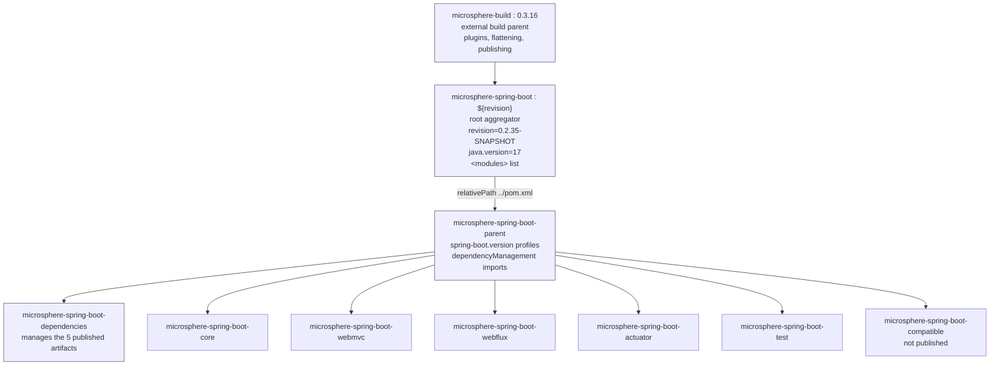

# Parent POM

> [中文](./zh/parent.md) · [Documentation index](../README.md)

> **Branch:** `release` · **Version line:** `0.2.x` · **Artifact:** `microsphere-spring-boot-parent`
> **Packaging:** `pom` · **Spring Boot:** `3.0.13` – `4.1.1` (profile-selected) · **Java:** 17

Contents:
[1 Module Overview](#1-module-overview) ·
[2 Coordinates and Version Information](#2-coordinates-and-version-information) ·
[3 POM Inheritance Chain](#3-pom-inheritance-chain) ·
[4 Managed Properties](#4-managed-properties) ·
[5 Dependency Management](#5-dependency-management) ·
[6 Build Repositories](#6-build-repositories) ·
[7 Spring Boot Version Profiles](#7-spring-boot-version-profiles) ·
[8 How to Use the Parent](#8-how-to-use-the-parent) ·
[9 What the Parent Does Not Do](#9-what-the-parent-does-not-do) ·
[10 Troubleshooting](#10-troubleshooting) ·
[11 See Also](#11-see-also)

---

## 1. Module Overview

`microsphere-spring-boot-parent` is the Bill-of-Management layer for the whole reactor. It is a
`<packaging>pom</packaging>` module that ships no classes; its job is to pin, for every library
module in the build:

* which Spring Boot release line is being compiled and tested against,
* which third-party BOMs are imported (`spring-boot-dependencies`, `microsphere-spring-dependencies`,
  `junit-bom`),
* the versions of the few artifacts that no imported BOM manages (`jolokia-core`),
* the extra Maven repositories required to resolve those artifacts.

Every publishable module in the reactor declares it as `<parent>`, which is why you never write a
version number on a Spring Boot or Microsphere dependency inside this project.

You use the parent in two ways:

| Use | When |
|---|---|
| As `<parent>` in your own POM | You want the same plugin setup and the same version pins for a multi-module company project. |
| Not at all, only the BOM | Your application already inherits `spring-boot-starter-parent`. See [dependencies.md](./dependencies.md). |

---

## 2. Coordinates and Version Information

```xml
<groupId>io.github.microsphere-projects</groupId>
<artifactId>microsphere-spring-boot-parent</artifactId>
<version>${revision}</version>
<packaging>pom</packaging>
```

| Fact | Value on `release` |
|---|---|
| Version property source | Root aggregator `pom.xml`, `<revision>0.2.35-SNAPSHOT</revision>` |
| Last published release | `0.2.34` |
| Java baseline | `<java.version>17</java.version>`, declared in the root aggregator |
| External build parent | `io.github.microsphere-projects:microsphere-build:0.3.16` |
| Managed by the BOM? | **No** — a parent POM is never a managed dependency |
| Published to Central? | Yes |

The parent inherits `${revision}` from the root aggregator rather than repeating a literal version, so
the entire reactor always shares one version string (Maven CI-friendly versions).

---

## 3. POM Inheritance Chain



Two distinct relationships are in play, and mixing them up is the usual source of confusion:

* **Aggregation** (`<modules>` in the root POM) controls *what one build command compiles*.
* **Inheritance** (`<parent>`) controls *what a POM gets from another POM* — properties, plugin
  configuration, and `dependencyManagement`.

`microsphere-spring-boot-parent` inherits from the root aggregator (`../pom.xml`), and the root
aggregator inherits from the external `microsphere-build` parent. The BOM and all jar modules inherit
from `microsphere-spring-boot-parent`.

---

## 4. Managed Properties

Declared in `microsphere-spring-boot-parent/pom.xml`:

| Property | Value | Purpose |
|---|---|---|
| `microsphere-spring.version` | `0.2.39` | Version of `microsphere-spring-dependencies`, the BOM of the sibling `microsphere-spring` project (supplies `microsphere-spring-context`, `microsphere-annotation-processor`, …). |
| `jolokia.version` | `2.6.3` | Version of `org.jolokia:jolokia-core`, used by the Actuator module's JMX endpoint tests. |
| `junit-jupiter.version` | `6.1.3` | Version of the `org.junit:junit-bom` import. |

Inherited from the root aggregator:

| Property | Value | Purpose |
|---|---|---|
| `revision` | `0.2.35-SNAPSHOT` | Single source of truth for the reactor version. |
| `java.version` | `17` | Compiler source/target consumed by the `microsphere-build` plugin setup. |

`spring-boot.version` is **not** a plain property: it is only ever set inside a profile (see §7), so
its value is undefined until a profile activates.

---

## 5. Dependency Management

The parent's `<dependencyManagement>` block is small by design; it delegates to BOMs.

```xml
<dependencyManagement>
    <dependencies>
        <!-- JUnit Jupiter -->
        <dependency>
            <groupId>org.junit</groupId>
            <artifactId>junit-bom</artifactId>
            <version>${junit-jupiter.version}</version>
            <type>pom</type>
            <scope>import</scope>
        </dependency>

        <!-- Jolokia -->
        <dependency>
            <groupId>org.jolokia</groupId>
            <artifactId>jolokia-core</artifactId>
            <version>${jolokia.version}</version>
        </dependency>

        <!-- Spring Boot Dependencies -->
        <dependency>
            <groupId>org.springframework.boot</groupId>
            <artifactId>spring-boot-dependencies</artifactId>
            <version>${spring-boot.version}</version>
            <type>pom</type>
            <scope>import</scope>
        </dependency>

        <!-- Microsphere Spring Dependencies -->
        <dependency>
            <groupId>io.github.microsphere-projects</groupId>
            <artifactId>microsphere-spring-dependencies</artifactId>
            <version>${microsphere-spring.version}</version>
            <type>pom</type>
            <scope>import</scope>
        </dependency>
    </dependencies>
</dependencyManagement>
```

| Entry | Kind | Why it is here |
|---|---|---|
| `junit-bom` | import | Aligns every `org.junit.*` artifact, including the platform launcher used by Surefire. |
| `jolokia-core` | direct version | Not managed by `spring-boot-dependencies`, and the Actuator module needs it pinned. |
| `spring-boot-dependencies` | import | Supplies versions for `spring-boot-*`, Spring Framework, Jackson, Servlet API, Micrometer, and the test starters. |
| `microsphere-spring-dependencies` | import | Supplies versions for the lower-level Microsphere libraries the core module depends on. |

Consequence for module POMs: a module can write a dependency with no `<version>` at all, as long as one
of these three BOMs knows it. That is exactly what `microsphere-spring-boot-core/pom.xml` does for
`microsphere-spring-context` and `spring-boot-starter`.

**Import order matters.** Maven resolves `dependencyManagement` first-match-wins across the reactor and
imported BOMs; entries declared earlier in the POM win over later ones. `junit-bom` is listed first so
its JUnit versions win over any JUnit version `spring-boot-dependencies` would otherwise suggest.

---

## 6. Build Repositories

```xml
<repositories>
    <repository>
        <id>spring-milestone</id>
        <name>Spring Portfolio Milestone Repository</name>
        <url>https://repo.spring.io/milestone</url>
    </repository>
</repositories>
```

This repository is present on the `release` branch and **absent** on `release-1.x`. It is needed
because the newest supported Spring Boot lines can be cut against milestone or release-candidate
builds (for example a `4.1` RC), which Maven Central does not host. If you inherit this parent and
your build is air-gapped, override the repository or drop the profiles that need it.

---

## 7. Spring Boot Version Profiles

One profile per Spring Boot minor line, each pinning a single patch release:

| Profile | `spring-boot.version` | Notes |
|---|---|---|
| `spring-boot-3.0` | `3.0.13` | |
| `spring-boot-3.1` | `3.1.12` | |
| `spring-boot-3.2` | `3.2.12` | |
| `spring-boot-3.3` | `3.3.13` | |
| `spring-boot-3.4` | `3.4.13` | |
| `spring-boot-3.5` | `3.5.16` | `<activeByDefault>true</activeByDefault>` |
| `spring-boot-4.0` | `4.0.8` | Also attaches `microsphere-spring-boot-compatible` to the core module. |
| `spring-boot-4.1` | `4.1.1` | Same attachment as `spring-boot-4.0`. |

Reading the matrix:

* The pinned patch is the exact version each line is **built and tested** against. Other patch releases
  in the same minor line are expected to work but are not exercised by CI.
* Activating any profile explicitly deactivates the `activeByDefault` one, so you never get two
  `spring-boot.version` values at once. Do not combine `-Pspring-boot-3.4 -Pspring-boot-3.5`; the result
  is the last-activated profile, which is easy to misread in logs.
* A build with no `-P` at all targets Spring Boot `3.5.16`.

```bash
# build and test the whole reactor against Spring Boot 3.5.16 (default)
./mvnw clean verify

# the same reactor against Spring Boot 4.1.1, plus the compatible shims
./mvnw clean verify -Pspring-boot-4.1

# what actually gets used for one module
./mvnw -pl microsphere-spring-boot-core -am -Pspring-boot-3.1 help:effective-pom | grep spring-boot.version
```

---

## 8. How to Use the Parent

### 8.1 Inherit it

```xml
<parent>
    <groupId>io.github.microsphere-projects</groupId>
    <artifactId>microsphere-spring-boot-parent</artifactId>
    <version>0.2.34</version>
</parent>

<groupId>com.example</groupId>
<artifactId>example-service</artifactId>

<dependencies>
    <dependency>
        <groupId>io.github.microsphere-projects</groupId>
        <artifactId>microsphere-spring-boot-webmvc</artifactId>
        <!-- no version here: see the caveat below -->
    </dependency>
</dependencies>
```

Caveat: inheriting the parent gives you Spring Boot's managed versions, but the five Microsphere
artifacts are managed by the **BOM**, not by the parent. Either import the BOM as shown in
[dependencies.md](./dependencies.md) or state the version explicitly.

### 8.2 Choose a Spring Boot line

```bash
mvn -Pspring-boot-3.5 clean package   # default, 3.5.16
mvn -Pspring-boot-4.0 clean package   # 4.0.8
```

### 8.3 Override a single version

Properties beat profiles, so pinning one artifact in your own `<properties>` is usually enough:

```xml
<properties>
    <jolokia.version>2.6.3</jolokia.version>
    <microsphere-spring.version>0.2.39</microsphere-spring.version>
</properties>
```

---

## 9. What the Parent Does Not Do

| Myth | Reality |
|---|---|
| "It manages the Microsphere Spring Boot artifact versions." | That is `microsphere-spring-boot-dependencies`. |
| "It bundles plugin configuration for Spring Boot applications." | It does not touch `spring-boot-maven-plugin`; that belongs to `spring-boot-starter-parent`. |
| "Activating a profile changes the Java version." | `java.version` is fixed at `17` on this branch; profiles only change `spring-boot.version`, and on `4.0`/`4.1` they additionally attach the `compatible` module to `core`. |
| "It is a dependency." | It is a POM parent; depending on it is meaningless. |

---

## 10. Troubleshooting

| Symptom | Cause | Fix |
|---|---|---|
| `'dependencies.dependency.version' for org.springframework.boot:spring-boot-starter:jar is missing` | No profile supplied `spring-boot.version`, or the profile was mistyped. | Use a profile id from §7 exactly, e.g. `-Pspring-boot-3.2`. |
| Could not resolve a Spring Boot `4.x` RC artifact | Repository missing from your own POM. | Inherit this parent, or add `https://repo.spring.io/milestone` yourself. |
| Modules compile against the wrong Boot line | Several profiles activated; only one wins. | Keep a single `-P` per build; CI does the same. |
| `microsphere-spring-boot-compatible` absent from the reactor output | You are on a Boot `3.x` profile, which does not attach it. | Expected; the shims are only compiled in when `spring-boot.version` is `4.0` or higher. |
| `${revision}` appears literally in a published POM | You installed from a working tree without flattening. | Use the published artifacts, or run the reactor build that activates the flatten step. |

---

## 11. See Also

| Document | Scope |
|---|---|
| [dependencies.md](./dependencies.md) | The BOM that manages the five published artifacts. |
| [core.md](./core.md) | The module that inherits the parent and conditionally depends on `compatible`. |
| [compatible.md](./compatible.md) | The build-only shim module excluded from the BOM. |
| [README.md](./README.md) | Branch overview, installation, and quick start. |

**Developer Guide:** see the developer guide index for the architecture and source analysis of this
module.
