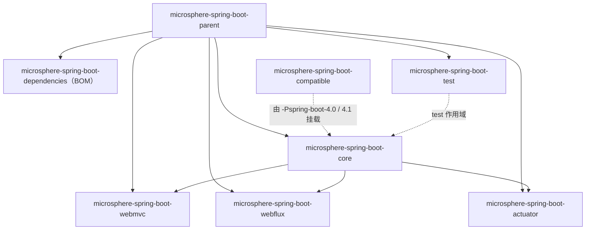

# `release` 分支（0.2.x）文档总览

> [English](../README.md) · 文档索引：[中文](../../zh/README.md)

> **分支：** `release` · **版本线：** `0.2.x` · **Spring Boot：** `3.0` – `4.1`
>
> 其他分支文档：Spring Boot 2.x 见 [../../1.x/README.md](../../1.x/README.md)。

---

## 1. 版本信息

| 项目 | 值 |
|---|---|
| Group ID | `io.github.microsphere-projects` |
| 最新发布版本 | `0.2.34`（Maven Central，2026-08-31） |
| 分支在研版本 | `0.2.35-SNAPSHOT`（根 `pom.xml` 的 `<revision>`） |
| Java 基线 | `17`（根 `pom.xml` 的 `<java.version>17</java.version>`） |
| Maven | 3.9+；分支内置 wrapper 为 apache-maven `3.9.16` |
| 构建父 POM | `microsphere-build:0.3.16` |
| 关键传递依赖 | `microsphere-spring:0.2.39`（BOM）、`jolokia:2.6.3`、`junit-bom:6.1.3`、`spring-boot-dependencies:${spring-boot.version}` |
| 许可 | Apache License 2.0 |

**说明.** `0.2.x` 线只支持 Spring Boot 3 与 4。Spring Boot 2.x 请使用 `0.1.x` 线（见
[../../1.x/README.md](../../1.x/README.md)）。不存在跨代产物。

---

## 2. Spring Boot 兼容范围

每个 Maven profile 锁定一个 minor 线的 patch 版本，CI 会遍历全部组合（JDK `17 / 21 / 25` × 下表 8 条 profile，共 24 组）。
同一 minor 线的其他 patch 版本按惯例可用。

| Profile | Spring Boot | 状态 |
|---|---|---|
| `-Pspring-boot-3.0` | `3.0.13` | 支持 |
| `-Pspring-boot-3.1` | `3.1.12` | 支持 |
| `-Pspring-boot-3.2` | `3.2.12` | 支持 |
| `-Pspring-boot-3.3` | `3.3.13` | 支持 |
| `-Pspring-boot-3.4` | `3.4.13` | 支持 |
| `-Pspring-boot-3.5` | `3.5.16` | **默认**（`activeByDefault`） |
| `-Pspring-boot-4.0` | `4.0.8` | 支持；需要 `compatible` shim，见 [compatible.md](./compatible.md) |
| `-Pspring-boot-4.1` | `4.1.1` | 支持；需要 `compatible` shim |

`SpringBootVersion` 枚举在本分支建模 `SPRING_BOOT_3_0` … `SPRING_BOOT_4_1_0`，外加运行时探测常量 `CURRENT`
（详见 [core.md](./core.md)）。

---

## 3. 模块清单

每个模块都有一份用户文档（中文在此，英文为同名 `../<file>.md`）和一份位于 `../../../developer-guide/current/zh/` 的开发者文档。

| 模块 | Artifact ID | BOM 管理 | 发布 | 用户文档 | 开发者文档 |
|---|---|---|---|---|---|
| 反应堆根 | `microsphere-spring-boot` | — | 否 | [parent.md](./parent.md) | [parent.md](../../../developer-guide/current/zh/parent.md) |
| Parent POM | `microsphere-spring-boot-parent` | 否 | 是 | [parent.md](./parent.md) · [English](../parent.md) | [parent.md](../../../developer-guide/current/zh/parent.md) |
| BOM | `microsphere-spring-boot-dependencies` | — | 是 | [dependencies.md](./dependencies.md) · [English](../dependencies.md) | [dependencies.md](../../../developer-guide/current/zh/dependencies.md) |
| Core | `microsphere-spring-boot-core` | 是 | 是 | [core.md](./core.md) · [English](../core.md) | [core.md](../../../developer-guide/current/zh/core.md) |
| Actuator | `microsphere-spring-boot-actuator` | 是 | 是 | [actuator.md](./actuator.md) · [English](../actuator.md) | [actuator.md](../../../developer-guide/current/zh/actuator.md) |
| Web MVC | `microsphere-spring-boot-webmvc` | 是 | 是 | [webmvc.md](./webmvc.md) · [English](../webmvc.md) | [webmvc.md](../../../developer-guide/current/zh/webmvc.md) |
| WebFlux | `microsphere-spring-boot-webflux` | 是 | 是 | [webflux.md](./webflux.md) · [English](../webflux.md) | [webflux.md](../../../developer-guide/current/zh/webflux.md) |
| Test | `microsphere-spring-boot-test` | 是 | 是 | [test.md](./test.md) · [English](../test.md) | [test.md](../../../developer-guide/current/zh/test.md) |
| Compatible | `microsphere-spring-boot-compatible` | **否** | **否**（`maven-deploy-plugin` skip + `skipPublishing`） | [compatible.md](./compatible.md) · [English](../compatible.md) | [compatible.md](../../../developer-guide/current/zh/compatible.md) |



`actuator`、`webmvc`、`webflux` 都依赖 `core`，引入任一者都会传递带来 `core` 的能力。

---

## 4. 安装

### 4.1 导入 BOM

```xml

<properties>
    <microsphere-spring-boot.version>0.2.34</microsphere-spring-boot.version>
</properties>

<dependencyManagement>
    <dependencies>
        <dependency>
            <groupId>io.github.microsphere-projects</groupId>
            <artifactId>microsphere-spring-boot-dependencies</artifactId>
            <version>${microsphere-spring-boot.version}</version>
            <type>pom</type>
            <scope>import</scope>
        </dependency>
    </dependencies>
</dependencyManagement>
```

`microsphere-spring-boot-dependencies` 只管理 `core`、`webmvc`、`webflux`、`actuator`、`test` 五个产物；`compatible` 不在其中，
也不应被直接依赖。

### 4.2 按需添加模块

```xml

<dependencies>
    <!-- 配置、条件、诊断 -->
    <dependency>
        <groupId>io.github.microsphere-projects</groupId>
        <artifactId>microsphere-spring-boot-core</artifactId>
    </dependency>

    <!-- 自定义端点与被监控调度器 -->
    <dependency>
        <groupId>io.github.microsphere-projects</groupId>
        <artifactId>microsphere-spring-boot-actuator</artifactId>
    </dependency>

    <!-- Servlet 栈专用 -->
    <dependency>
        <groupId>io.github.microsphere-projects</groupId>
        <artifactId>microsphere-spring-boot-webmvc</artifactId>
    </dependency>

    <!-- 仅测试期 -->
    <dependency>
        <groupId>io.github.microsphere-projects</groupId>
        <artifactId>microsphere-spring-boot-test</artifactId>
        <scope>test</scope>
    </dependency>
</dependencies>
```

响应式应用请把 `webmvc` 换成 `webflux`；两者可共存，各自的可用性条件会只在匹配的 Web 应用类型下生效。

### 4.3 验证安装

```java
import io.microsphere.spring.boot.SpringBootVersion;
import org.springframework.boot.SpringApplication;
import org.springframework.boot.autoconfigure.SpringBootApplication;

@SpringBootApplication
public class MyApplication {

    public static void main(String[] args) {
        // 例如输出：Microsphere Spring Boot 0.2.34 on Spring Boot 3.5.16
        System.out.println("Spring Boot: " + SpringBootVersion.CURRENT.getVersion());
        SpringApplication.run(MyApplication.class, args);
    }
}
```

引入 `core` 后，`server.shutdown` 会立刻变成 `graceful`——这来自 `core` 自带的默认属性文件，不是你配错了。详见
[core.md](./core.md)。

---

## 5. 能力速览

| 想做什么 | 用到的能力 | 文档 |
|---|---|---|
| 让库自带可覆盖的默认配置 | `META-INF/config/default/*.properties` + `DefaultPropertiesPostProcessor` | [core.md](./core.md) |
| 多个模块各自排除自动配置而不互相覆盖 | `microsphere.autoconfigure.exclude` | [core.md](./core.md) |
| 按 Spring Boot 版本分支代码 | `SpringBootVersion` | [core.md](./core.md) |
| 一组前缀属性存在才注册 Bean | `@ConditionalOnPropertyPrefix` | [core.md](./core.md) |
| 观察/审计配置绑定 | `BindListener`、`ListenableBindHandlerAdapter` | [core.md](./core.md) |
| 响应配置项实时变化 | `ConfigurationPropertiesBeanPropertyChangedEvent` | [core.md](./core.md) |
| 启动即暴露 classpath 冲突 | banned artifacts、artifact collision + `FailureAnalyzer` | [core.md](./core.md) |
| 查看部署了哪些 JAR | `GET /actuator/microsphere/artifacts` | [actuator.md](./actuator.md) |
| 一次调用拿到全部端点数据 | `GET /actuator/microsphere/web/endpoints` | [actuator.md](./actuator.md) |
| 定时任务指标 | `MonitoredThreadPoolTaskScheduler` / `actuatorTaskScheduler` | [actuator.md](./actuator.md) |
| Servlet/响应式栈扩展 | `WebMvcAutoConfiguration`、`WebFluxAutoConfiguration` | [webmvc.md](./webmvc.md) · [webflux.md](./webflux.md) |
| 自动配置类单测 | `AutoConfigurationTest` 系列基类 | [test.md](./test.md) |

---

## 6. 从源码构建

```bash
git clone https://github.com/microsphere-projects/microsphere-spring-boot.git
cd microsphere-spring-boot
git checkout release            # 本文档对应的分支

./mvnw verify                   # 默认 profile：Spring Boot 3.5.16
./mvnw verify -Pspring-boot-3.0 # 其他 minor 线
./mvnw verify -Pspring-boot-4.1 # 会附带 compatible shim 模块
./mvnw install -DskipTests      # 安装到本地仓库
```

CI 使用的命令形态（便于你在本地复现同一矩阵）：

```bash
./mvnw --batch-mode --update-snapshots -Drevision=0.0.1-SNAPSHOT \
       -Dsurefire.useSystemClassLoader=false test \
       --activate-profiles test,coverage,spring-boot-3.5
```

---

## 7. 常见问题（跨模块）

| 现象 | 结论 |
|---|---|
| 想要 `0.2.x` 但项目是 Boot 2.7 | 不行。Boot 2.x 请用 `0.1.x`（[../../1.x/README.md](../../1.x/README.md)）。 |
| 默认属性把我的配置覆盖了？ | 不会。它们进入 `defaultProperties`（最低优先级）。 |
| `compatible` 在 Maven Central 找不到 | 有意为之：该模块不发布、也不在 BOM 中，只在 Boot 4.x profile 构建 `core` 时附加。 |
| 端点返回 404 | 检查 `management.endpoints.enabled-by-default=false`（本库默认）与 `management.endpoint.<id>.enabled`，见 [actuator.md](./actuator.md)。 |
