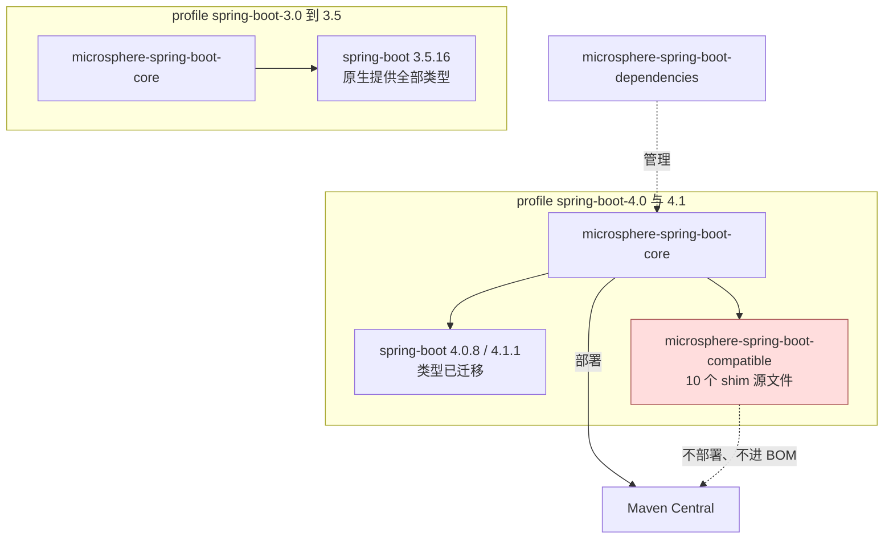

# Compatible 模块（构建期兼容层）

> [English](../compatible.md) · 文档索引：[中文](../../zh/README.md)

> **分支：** `release` · **版本线：** `0.2.x` · **Artifact：** `microsphere-spring-boot-compatible`
> **Spring Boot：** `4.0.8` / `4.1.1`（仅 profile） · **是否发布：** 否 · **是否在 BOM：** 否 · **打包：** jar

目录：
[1 模块概览](#1-模块概览) ·
[2 版本信息](#2-版本信息) ·
[3 shim 清单](#3-shim-清单) ·
[4 模块如何被挂载](#4-模块如何被挂载) ·
[5 替代手段：按类名引用](#5-替代手段按类名引用) ·
[6 给应用开发者的建议](#6-给应用开发者的建议) ·
[7 在 Boot 4 profile 下构建本项目](#7-在-boot-4-profile-下构建本项目) ·
[8 缺少 shim 时的报错形态](#8-缺少-shim-时的报错形态) ·
[9 常见问题](#9-常见问题) ·
[10 参考](#10-参考)

---

## 1. 模块概览

`microsphere-spring-boot-compatible` 不是给应用使用的库，而是一个**构建期兼容层模块**：它在
`org.springframework.boot.*` 原始包名下重新声明了一小组 Spring Boot 类型，使得当所选 Spring Boot 版本已经
迁移或移除这些类型时，reactor 的其余模块仍然可以编译。

模块自身在 `src/main/java/org/springframework/boot/package-info.java` 里说明了来源：

```java
/**
 * The classes in this package or sub-packages are forked from the Spring Boot 3.5.x,
 * which will be used to be compatible with the lower versions of Spring Boot.
 */
```

在本分支上，这些 shim 存在的原因是 Spring Boot 4 迁移了 auto-configure 配置属性类与 bootstrap 上下文 API。
没有它们，同一份源码无法同时构建 Boot 3 与 Boot 4。

| 问题 | 回答 |
|---|---|
| 谁使用它 | 只有 `microsphere-spring-boot-core`，且仅在两个 profile 下。 |
| 谁绝不能使用它 | 你的应用、你的库，以及 BOM。 |
| 里面有什么 | `src/main/java/org/springframework/boot/` 下的 9 个类型 + 1 个 `package-info`。 |

---

## 2. 版本信息

| 项目 | 取值 |
|---|---|
| 坐标 | `io.github.microsphere-projects:microsphere-spring-boot-compatible` |
| 版本 | `${revision}`，分支尖端即 `0.2.35-SNAPSHOT` |
| 包含它的已发布版本 | **无** —— 任何 `0.2.x` 发布版本都未部署它 |
| 部署 | `maven-deploy-plugin` `<skip>true</skip>` |
| Central 发布 | `central-publishing-maven-plugin` `<skipPublishing>true</skipPublishing>` |
| 是否被 `microsphere-spring-boot-dependencies` 管理 | 否 —— BOM 只管理 `core`、`webmvc`、`webflux`、`actuator`、`test` |
| fork 来源 | Spring Boot `3.5.x`（本分支默认 profile） |
| 挂载它的 profile | `spring-boot-4.0`（`4.0.8`）、`spring-boot-4.1`（`4.1.1`） |
| 不使用它的 profile | `spring-boot-3.0` … `spring-boot-3.5`，含默认的 `3.5.16` |
| Java | 17 基线，与本版本线其余模块一致 |

---

## 3. shim 清单

| 全限定类型 | 嵌套类型 | Boot 中引入版本 | 此处为何需要 shim |
|---|---|---|---|
| `org.springframework.boot.BootstrapContext` | — | 2.4.0 | Boot 4 迁移了 bootstrap API。 |
| `org.springframework.boot.BootstrapRegistry` | `InstanceSupplier<T>`、`InstanceScope` | 2.4.0（scope API 为 2.4.2） | 同上。 |
| `org.springframework.boot.ConfigurableBootstrapContext` | — | 2.4.0 | 同上。 |
| `org.springframework.boot.DefaultBootstrapContext` | — | 2.4.0 | 同上。 |
| `org.springframework.boot.BootstrapContextClosedEvent` | — | 2.4.0 | 同上。 |
| `org.springframework.boot.web.servlet.MultipartConfigFactory` | — | 1.4.0 | Boot 4 迁移了该 servlet 工厂类型。 |
| `org.springframework.boot.autoconfigure.web.ServerProperties` | — | 1.0.0（`@ConfigurationProperties("server")`） | 配置属性类被移出 `autoconfigure`。 |
| `org.springframework.boot.autoconfigure.web.servlet.MultipartProperties` | — | 2.0.0（`spring.servlet.multipart`） | 同上。 |
| `org.springframework.boot.autoconfigure.jackson.JacksonProperties` | — | 1.2.0（`spring.jackson`） | 同上。 |
| `org.springframework.boot.package-info` | — | 1.0.0 | 记录 fork 来源与意图。 |

阅读 shim 时值得注意的两点：

* bootstrap 系列类型是 Boot 2.4 的 API 面貌 —— `get`、`getOrElse`、`getOrElseSupply`、`getOrElseThrow`、
  `isRegistered` —— 正是 `core` 的 `SpringApplicationRunListener` 适配器所调用的那一组。
* 属性类是可用的 `@ConfigurationProperties` bean，而不是空壳：`core` 的测试会通过它们绑定真实值，
  因此 shim 必须带上同样的访问器。

由于这些全限定名与 Spring Boot 自身的完全相同，shim 类在 Boot 3 的 classpath 上会成为**重复类**。
这正是该模块永不发布、也不会进入本 reactor 之外任何运行期 classpath 的原因。

### `1.x` 线的差异

`release-1.x` 上同一个模块带 **12** 个文件，动机也不同：五个 bootstrap 类型之外，还有
`actuate.endpoint.EndpointId`、`context.properties.ConstructorBinding`、端点可用性条件三件套
（`AbstractEndpointCondition`、`ConditionalOnAvailableEndpoint`、`OnAvailableEndpointCondition`）以及
`actuate.autoconfigure.endpoint.expose.IncludeExcludeEndpointFilter`，并且改由 `spring-boot-2.1`、
`spring-boot-2.2`、`spring-boot-2.3` 三个 profile 挂载。见
[Compatible 模块（1.x 线）](../../1.x/zh/compatible.md)。

---

## 4. 模块如何被挂载

`microsphere-spring-boot-core/pom.xml` 在两个 profile 内添加它（第 97–121 行）：

```xml
<profiles>
    <profile>
        <id>spring-boot-4.0</id>
        <dependencies>
            <dependency>
                <groupId>io.github.microsphere-projects</groupId>
                <artifactId>microsphere-spring-boot-compatible</artifactId>
                <version>${revision}</version>
            </dependency>
        </dependencies>
    </profile>

    <profile>
        <id>spring-boot-4.1</id>
        <dependencies>
            <!-- 与上面的块完全相同 -->
        </dependencies>
    </profile>
</profiles>
```

`actuator`、`webmvc`、`webflux`、`test` 都**不引用**它。在根 POM 的 `<modules>` 顺序里 `compatible` 排在
`core` 之前，因此 Boot 4 profile 构建会先编译 shim，随后 `core` 从本地 reactor 解析到它。



---

## 5. 替代手段：按类名引用

shim 是更重的手段。当某个类只是*换了包名*、且仅以字符串形式出现在条件注解里时，本项目不做 fork，
而是同时列出两个名字：

| 手段 | 何时使用 | 本项目中的例子 |
|---|---|---|
| 按名字声明条件/顺序 | 类只被按名引用，且两个名字都能列出。 | `webmvc` / `webflux` 的 `@AutoConfigureAfter(name = { ... })`，见 [webmvc.md](../webmvc.md)。 |
| `compatible` shim | 类出现在 `import`、`extends`、注解类型或绑定代码路径中，编译期必须存在。 | `ConfigurableBootstrapContext`、`ServerProperties`、`JacksonProperties`、`MultipartProperties`。 |

---

## 6. 给应用开发者的建议

1. **不要把它写进你的 POM。** 它没有发布，解析必然失败：
   `Could not find artifact io.github.microsphere-projects:microsphere-spring-boot-compatible`。
2. **不要在 BOM 里找它。** 排除它是有意的；BOM 的承诺是"列在这里的都拉得到"。
3. **你并不需要它。** 依赖 `microsphere-spring-boot-core` 得到的是针对其发布时所选 Boot 版本线编译好的
   jar，运行期无需任何额外东西，shim 也不会作为传递依赖暴露出来。
4. **不要在你自己的代码里 import shim 的 `org.springframework.boot.*` 类型。** 这些包名属于 Spring Boot，
   副本只存在于本 reactor 内。请使用你的应用自身 Spring Boot 提供的类型。

给贡献者的两条规则：

1. 新增 shim 时，包名与类名必须与 Spring Boot **完全一致**，否则 `core` 里的 `import` 无法在两代之间保持不变。
2. 不要把它加入 BOM，也不要加入任何已发布模块的默认 compile 作用域 —— 像 `core` 那样只在需要的 profile 内挂载。

---

## 7. 在 Boot 4 profile 下构建本项目

```bash
# Boot 4.1.1，编译入 shim
./mvnw clean verify -Pspring-boot-4.1

# Boot 4.0.8
./mvnw clean verify -Pspring-boot-4.0

# Boot 3.5.16（默认）：模块仍会构建，但无人依赖它
./mvnw clean verify

# 确认 core 是否真的拿到了 shim
./mvnw -pl microsphere-spring-boot-core -am -Pspring-boot-4.1 dependency:tree | grep microsphere-spring-boot-compatible
```

最后这条命令只有在 Boot 4 profile 下才会输出该依赖。`-am` 很关键：只构建 `core` 而不一起构建
`compatible` 会失败，因为 shim 只存在于 reactor 之内。

---

## 8. 缺少 shim 时的报错形态

如果你在 Boot 4 profile 下构建却没有挂载该模块 —— 例如去掉 `-am`，或删掉 profile 块 —— 预期出现下列
错误，每一条都能对应到源码里真实的引用点：

| 报错 | 需要 shim 的引用位置 |
|---|---|
| `cannot find symbol class ConfigurableBootstrapContext` | `io/microsphere/spring/boot/listener/SpringApplicationRunListenerAdapter.java`、`LoggingSpringApplicationRunListener.java` |
| `cannot find symbol class ServerProperties` | `io/microsphere/spring/boot/util/TestUtils.java` 以及多个 `core` 测试 |
| `cannot find symbol class JacksonProperties` | `ConfigurationPropertiesBeanContextTest` |
| `cannot find symbol class MultipartProperties` | `ConfigurationPropertiesBeanInfoTest` |
| `cannot find symbol class MultipartConfigFactory` | servlet multipart 相关代码路径 |

在 Boot 3 profile 下这些错误都不会出现，因为 Spring Boot 自己在相同坐标提供了这些类型。

---

## 9. 常见问题

**为什么不写版本判断，而要 fork 类？**
缺失的是编译期类型和注解属性类型，不是运行期行为。反射判断修不了一个 `import`。

**为什么明确从 Spring Boot 3.5.x fork？**
那是本分支的默认 profile，也就是项目支持的最新 Boot 3 版本线，因此 shim 的 API 面貌与 `core` 默认编译所
面对的表面完全一致。

**shim 会泄漏进已发布的 jar 吗？**
不会。`core` 是针对它编译的，但该模块既不部署也不进 BOM，下游构建永远解析不到。只有你自己在本地
安装并显式依赖它，它的类才可能出现在 classpath 上。

**为什么 `1.x` 需要的 shim 比 `current` 多？**
把 Boot `2.1`–`2.3` 补齐到 Boot `2.7` 的 API 面貌，跨度更大：`@ConditionalOnAvailableEndpoint` 引入于
Boot 2.2，`IncludeExcludeEndpointFilter` 引入于 2.2.7，bootstrap API 引入于 2.4，因此需要重新提供的类型更多。

**如果我期待的某个类不在清单里？**
说明 Boot 4 仍在历史包名下提供它，无需 shim。

---

## 10. 参考

| 文档 | 范围 |
|---|---|
| [core.md](../core.md) | 这些 shim 的唯一使用者。 |
| [dependencies.md](../dependencies.md) | BOM，以及该 artifact 为何不进 BOM。 |
| [parent.md](../parent.md) | 选择 Boot 版本线的 profile。 |
| [webmvc.md](../webmvc.md) | 不依赖 shim 的按名引用技巧。 |
| [Compatible 模块（1.x）](../../1.x/zh/compatible.md) | 同一机制在 Boot 2 侧的形态。 |
