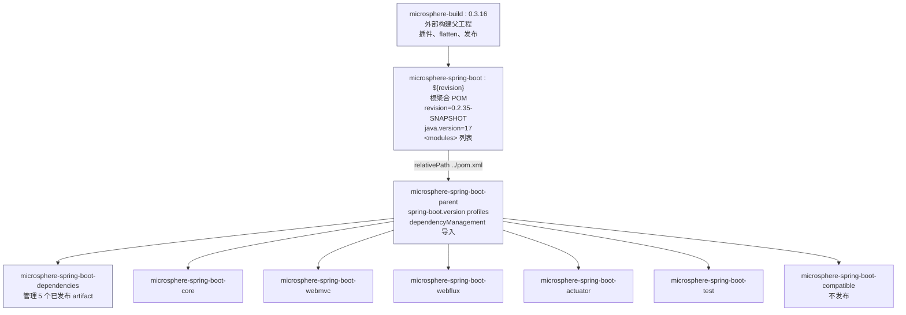

# Parent POM（父工程）

> [English](../parent.md) · 文档索引：[中文](../../zh/README.md)

> **分支：** `release` · **版本线：** `0.2.x` · **Artifact：** `microsphere-spring-boot-parent`
> **打包：** `pom` · **Spring Boot：** `3.0.13` – `4.1.1`（由 profile 选择） · **Java：** 17

目录：
[1 模块概览](#1-模块概览) ·
[2 坐标与版本信息](#2-坐标与版本信息) ·
[3 POM 继承链](#3-pom-继承链) ·
[4 受管属性](#4-受管属性) ·
[5 依赖管理](#5-依赖管理) ·
[6 构建仓库](#6-构建仓库) ·
[7 Spring Boot 版本 profile](#7-spring-boot-版本-profile) ·
[8 如何使用 Parent](#8-如何使用-parent) ·
[9 Parent 不做的事](#9-parent-不做的事) ·
[10 故障排查](#10-故障排查) ·
[11 参考](#11-参考)

---

## 1. 模块概览

`microsphere-spring-boot-parent` 是整个 reactor 的版本管理层。它是 `<packaging>pom</packaging>` 模块，
不产出任何 class，职责是为构建里的每个库模块固定：

* 编译与测试针对哪一条 Spring Boot 版本线，
* 导入哪些第三方 BOM（`spring-boot-dependencies`、`microsphere-spring-dependencies`、`junit-bom`），
* 少数没有任何 BOM 覆盖的 artifact 版本（`jolokia-core`），
* 解析这些 artifact 所需的额外 Maven 仓库。

reactor 里每个会发布的模块都把它声明为 `<parent>`，这就是本项目中 Spring Boot 与 Microsphere 依赖都不
需要写版本号的原因。

你有两种使用方式：

| 用法 | 适用场景 |
|---|---|
| 在自己 POM 里作为 `<parent>` | 你希望公司多模块项目获得同一套插件配置与版本固定。 |
| 完全不继承，只用 BOM | 你的应用已经继承 `spring-boot-starter-parent`。见 [dependencies.md](../dependencies.md)。 |

---

## 2. 坐标与版本信息

```xml
<groupId>io.github.microsphere-projects</groupId>
<artifactId>microsphere-spring-boot-parent</artifactId>
<version>${revision}</version>
<packaging>pom</packaging>
```

| 事实 | `release` 分支取值 |
|---|---|
| 版本属性来源 | 根聚合 POM，`<revision>0.2.35-SNAPSHOT</revision>` |
| 最近发布版本 | `0.2.34` |
| Java 基线 | `<java.version>17</java.version>`，声明在根聚合 POM |
| 外部构建父工程 | `io.github.microsphere-projects:microsphere-build:0.3.16` |
| 是否被 BOM 管理 | **否** —— parent POM 不会作为受管依赖 |
| 是否发布到 Central | 是 |

Parent 从根聚合 POM 继承 `${revision}` 而不是重复写死版本，因此整个 reactor 始终共用一个版本串
（Maven CI-friendly versions）。

---

## 3. POM 继承链



这里有两条完全不同的关系，混淆它们是最常见的出错来源：

* **聚合**（根 POM 的 `<modules>`）决定*一条命令编译哪些模块*。
* **继承**（`<parent>`）决定*一个 POM 从另一个 POM 得到什么* —— 属性、插件配置、`dependencyManagement`。

`microsphere-spring-boot-parent` 继承根聚合 POM（`../pom.xml`），根聚合 POM 又继承外部的
`microsphere-build` 父工程。BOM 与所有 jar 模块都继承 `microsphere-spring-boot-parent`。

---

## 4. 受管属性

声明在 `microsphere-spring-boot-parent/pom.xml`：

| 属性 | 取值 | 作用 |
|---|---|---|
| `microsphere-spring.version` | `0.2.39` | `microsphere-spring-dependencies` 的版本，即同级 `microsphere-spring` 项目的 BOM（提供 `microsphere-spring-context`、`microsphere-annotation-processor` 等）。 |
| `jolokia.version` | `2.6.3` | `org.jolokia:jolokia-core` 的版本，Actuator 模块的 JMX 端点测试会用到。 |
| `junit-jupiter.version` | `6.1.3` | `org.junit:junit-bom` 导入的版本。 |

从根聚合 POM 继承：

| 属性 | 取值 | 作用 |
|---|---|---|
| `revision` | `0.2.35-SNAPSHOT` | reactor 版本的唯一来源。 |
| `java.version` | `17` | 编译 source/target，由 `microsphere-build` 的插件配置消费。 |

`spring-boot.version` **不是**普通属性：它只在 profile 内被赋值（见 §7），因此在任何 profile 激活之前它
是没有定义的。

---

## 5. 依赖管理

Parent 的 `<dependencyManagement>` 刻意保持精简，把工作交给 BOM。

```xml
<dependencyManagement>
    <dependencies>
        <!-- JUnit Jupiter -->
        <dependency>
            <groupId>org.junit</groupId>
            <artifactId>junit-bom</artifactId>
            <version>${junit-jupiter.version}</version>
            <type>pom</type>
            <scope>import</scope>
        </dependency>

        <!-- Jolokia -->
        <dependency>
            <groupId>org.jolokia</groupId>
            <artifactId>jolokia-core</artifactId>
            <version>${jolokia.version}</version>
        </dependency>

        <!-- Spring Boot Dependencies -->
        <dependency>
            <groupId>org.springframework.boot</groupId>
            <artifactId>spring-boot-dependencies</artifactId>
            <version>${spring-boot.version}</version>
            <type>pom</type>
            <scope>import</scope>
        </dependency>

        <!-- Microsphere Spring Dependencies -->
        <dependency>
            <groupId>io.github.microsphere-projects</groupId>
            <artifactId>microsphere-spring-dependencies</artifactId>
            <version>${microsphere-spring.version}</version>
            <type>pom</type>
            <scope>import</scope>
        </dependency>
    </dependencies>
</dependencyManagement>
```

| 条目 | 类型 | 为什么放在这里 |
|---|---|---|
| `junit-bom` | import | 对齐所有 `org.junit.*` artifact，包括 Surefire 使用的 platform launcher。 |
| `jolokia-core` | 直接固定版本 | `spring-boot-dependencies` 不管它，而 Actuator 模块需要固定版本。 |
| `spring-boot-dependencies` | import | 提供 `spring-boot-*`、Spring Framework、Jackson、Servlet API、Micrometer 与测试 starter 的版本。 |
| `microsphere-spring-dependencies` | import | 提供 core 模块依赖的底层 Microsphere 库版本。 |

对模块 POM 的直接结果：只要这三个 BOM 中有任何一个认识某个依赖，模块就可以完全省略 `<version>`。
`microsphere-spring-boot-core/pom.xml` 里的 `microsphere-spring-context` 与 `spring-boot-starter` 正是如此。

**导入顺序有意义。** Maven 对 `dependencyManagement` 采用先到先得的规则（包含被导入 BOM 的条目）；
POM 中较早声明的条目优先。`junit-bom` 排在最前，因此它的 JUnit 版本优先于
`spring-boot-dependencies` 可能给出的 JUnit 版本。

---

## 6. 构建仓库

```xml
<repositories>
    <repository>
        <id>spring-milestone</id>
        <name>Spring Portfolio Milestone Repository</name>
        <url>https://repo.spring.io/milestone</url>
    </repository>
</repositories>
```

该仓库只存在于 `release` 分支，`release-1.x` 分支上**没有**。之所以需要它，是因为较新的 Spring Boot
版本线可能针对 milestone 或 RC 构建（例如某个 `4.1` RC），而 Maven Central 不托管这些版本。
如果你继承了这个 parent 但构建环境是隔离网络，请覆盖该仓库或去掉需要它的 profile。

---

## 7. Spring Boot 版本 profile

每个 Spring Boot minor 版本线一个 profile，各自固定一个 patch 版本：

| Profile | `spring-boot.version` | 说明 |
|---|---|---|
| `spring-boot-3.0` | `3.0.13` | |
| `spring-boot-3.1` | `3.1.12` | |
| `spring-boot-3.2` | `3.2.12` | |
| `spring-boot-3.3` | `3.3.13` | |
| `spring-boot-3.4` | `3.4.13` | |
| `spring-boot-3.5` | `3.5.16` | `<activeByDefault>true</activeByDefault>` |
| `spring-boot-4.0` | `4.0.8` | 同时把 `microsphere-spring-boot-compatible` 挂到 core 模块。 |
| `spring-boot-4.1` | `4.1.1` | 与 `spring-boot-4.0` 相同的挂载。 |

如何读这张表：

* 固定的 patch 是该版本线**实际构建与测试**的版本；同线其他 patch 预期可用，但 CI 不覆盖。
* 显式激活任意 profile 都会让 `activeByDefault` 失效，因此不会出现两个 `spring-boot.version` 并存。
  不要写 `-Pspring-boot-3.4 -Pspring-boot-3.5`；生效的是后一个，日志里很容易看错。
* 完全不带 `-P` 的构建目标就是 Spring Boot `3.5.16`。

```bash
# 针对 Spring Boot 3.5.16（默认）构建并测试整个 reactor
./mvnw clean verify

# 同一 reactor 针对 Spring Boot 4.1.1，同时编译 compatible shim
./mvnw clean verify -Pspring-boot-4.1

# 查看某个模块实际使用的版本
./mvnw -pl microsphere-spring-boot-core -am -Pspring-boot-3.1 help:effective-pom | grep spring-boot.version
```

---

## 8. 如何使用 Parent

### 8.1 继承它

```xml
<parent>
    <groupId>io.github.microsphere-projects</groupId>
    <artifactId>microsphere-spring-boot-parent</artifactId>
    <version>0.2.34</version>
</parent>

<groupId>com.example</groupId>
<artifactId>example-service</artifactId>

<dependencies>
    <dependency>
        <groupId>io.github.microsphere-projects</groupId>
        <artifactId>microsphere-spring-boot-webmvc</artifactId>
        <!-- 这里不写版本，见下方说明 -->
    </dependency>
</dependencies>
```

说明：继承 parent 你会得到 Spring Boot 的受管版本，但那五个 Microsphere artifact 是由 **BOM** 管理的，
parent 并不管理它们。要么按 [dependencies.md](../dependencies.md) 导入 BOM，要么显式写版本。

### 8.2 选择 Spring Boot 版本线

```bash
mvn -Pspring-boot-3.5 clean package   # 默认，3.5.16
mvn -Pspring-boot-4.0 clean package   # 4.0.8
```

### 8.3 只覆盖某一个版本

属性优先级高于 profile，通常在自己 POM 的 `<properties>` 里固定即可：

```xml
<properties>
    <jolokia.version>2.6.3</jolokia.version>
    <microsphere-spring.version>0.2.39</microsphere-spring.version>
</properties>
```

---

## 9. Parent 不做的事

| 误解 | 事实 |
|---|---|
| “它管理 Microsphere Spring Boot 各 artifact 的版本。” | 那是 `microsphere-spring-boot-dependencies`。 |
| “它替 Spring Boot 应用配置好插件。” | 它不涉及 `spring-boot-maven-plugin`；那属于 `spring-boot-starter-parent`。 |
| “激活 profile 会改变 Java 版本。” | 该分支上 `java.version` 固定为 `17`；profile 只改 `spring-boot.version`，并在 `4.0`/`4.1` 时额外挂载 `compatible` 模块。 |
| “它是一个依赖。” | 它是 POM parent，作为依赖引入没有意义。 |

---

## 10. 故障排查

| 现象 | 原因 | 处理 |
|---|---|---|
| `'dependencies.dependency.version' for org.springframework.boot:spring-boot-starter:jar is missing` | 没有 profile 提供 `spring-boot.version`，或 profile 名拼错。 | 精确使用 §7 表中的 profile id，例如 `-Pspring-boot-3.2`。 |
| 无法解析 Spring Boot `4.x` RC artifact | 你自己的 POM 缺少仓库配置。 | 继承本 parent，或自行添加 `https://repo.spring.io/milestone`。 |
| 模块编译时用了错误的 Boot 版本线 | 同时激活了多个 profile，只有一个生效。 | 每次构建只保留一个 `-P`；CI 也是这样做的。 |
| reactor 输出里看不到 `microsphere-spring-boot-compatible` | 你用的是 Boot `3.x` profile，它不挂载该模块。 | 属预期行为；只有 `spring-boot.version` 为 `4.0` 及以上时才编译 shim。 |
| 已发布 POM 里出现字面量 `${revision}` | 从未展开 flatten 的工作树安装产物。 | 使用已发布 artifact，或运行会激活 flatten 的 reactor 构建。 |

---

## 11. 参考

| 文档 | 范围 |
|---|---|
| [dependencies.md](../dependencies.md) | 管理五个已发布 artifact 的 BOM。 |
| [core.md](../core.md) | 继承 parent 并条件依赖 `compatible` 的模块。 |
| [compatible.md](../compatible.md) | 仅构建期、不发布的 shim 模块。 |
| [README.md](../README.md) | 本分支概览、安装与快速开始。 |

开发者文档（架构设计与源码分析）见开发者文档索引。
