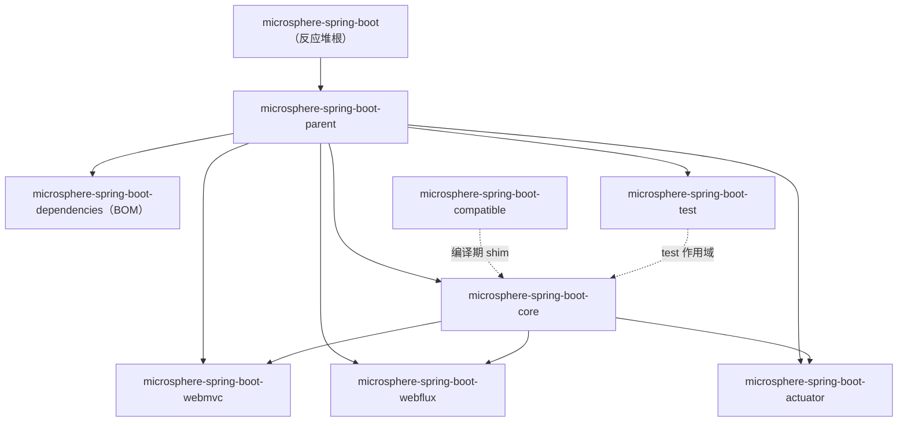

# 用户文档

> [English](../README.md) · [文档首页（中文）](../../zh/README.md) · [开发者文档（中文）](../../developer-guide/zh/README.md)

面向使用者的文档：说明每个 Maven 模块提供什么能力、如何引入构建、可直接参考的模块测试用例代码示例、它会读取的配置项，
以及它实际构建与测试所针对的 Spring Boot 版本。

内部实现（启动装配、源码解析、构建与发布流水线）请看[开发者文档](../../developer-guide/zh/README.md)。

---

## 1. 选择版本线

| 你的 Spring Boot | 使用 | 版本线 | 分支 | 文档 |
|---|---|---|---|---|
| `3.0` – `3.5` | `0.2.x` | `3.0.13` – `3.5.16` | `release` | [`current/`](../current/zh/README.md) · [English](../current/README.md) |
| `4.0` – `4.1` | `0.2.x` | `4.0.8` – `4.1.1` | `release` | [`current/`](../current/zh/README.md) · [English](../current/README.md) |
| `2.1` – `2.7` | `0.1.x` | `2.1.18.RELEASE` – `2.7.18` | `release-1.x` | [`1.x/`](../1.x/zh/README.md) · [English](../1.x/README.md) |

两条线不能混用：`0.1.x` 编译于 `javax.servlet` 并在 `spring.factories` 中注册自动配置，而 `0.2.x` 使用
`jakarta.servlet` 与 `AutoConfiguration.imports`。请按你的 Boot 代际取该线最新 patch（`0.2.x` 为 `0.2.34`，`0.1.x` 为 `0.1.34`）。

---

## 2. 模块文档

每个 Maven 模块一份文档，英文在主路径，中文在 `zh/`。

### `release` 分支 — 0.2.x（[分支目录](../current/zh/README.md)）

| 文档 | Artifact | 是否发布 | 内容 |
|---|---|---|---|
| [core](../current/zh/core.md) | `microsphere-spring-boot-core` | 是 | 可覆盖的默认属性、`SpringBootVersion` 版本判断、`microsphere.autoconfigure.exclude`、`@ConditionalOnPropertyPrefix`、`BindListener` 绑定回调、属性变更事件、禁用构件与构件冲突诊断、条件评估报告 |
| [actuator](../current/zh/actuator.md) | `microsphere-spring-boot-actuator` | 是 | 四个自定义端点（`artifacts`、`webEndpoints`、`configMetadata`、`configProperties`）、端点暴露与缓存默认策略、`MonitoredThreadPoolTaskScheduler` |
| [webmvc](../current/zh/webmvc.md) | `microsphere-spring-boot-webmvc` | 是 | Servlet 栈扩展：内容缓存过滤器、内容协商、处理器/拦截器日志、exclusive view resolver |
| [webflux](../current/zh/webflux.md) | `microsphere-spring-boot-webflux` | 是 | 响应式栈扩展 |
| [test](../current/zh/test.md) | `microsphere-spring-boot-test` | 是 | 把自动配置预期固化为继承即得的测试基类 |
| [compatible](../current/zh/compatible.md) | `microsphere-spring-boot-compatible` | 否 | 构建期自动挂载的 Boot 4.x shim，以及为什么不要直接依赖它 |
| [dependencies](../current/zh/dependencies.md) | `microsphere-spring-boot-dependencies` | 是（BOM） | BOM 管理哪些构件、如何导入 |
| [parent](../current/zh/parent.md) | `microsphere-spring-boot-parent` | 是（pom） | 父 POM：Java 基线、上游 BOM 导入、Boot 版本 profile |

### `release-1.x` 分支 — 0.1.x（[分支目录](../1.x/zh/README.md)）

| 文档 | Artifact | 与 0.2.x 的差异 |
|---|---|---|
| [core](../1.x/zh/core.md) | `microsphere-spring-boot-core` | `SpringBootVersion` 只建模 Boot `2.0` – `2.7.18`；`spring.factories` 与 `AutoConfiguration.imports` 双份注册 |
| [actuator](../1.x/zh/actuator.md) | `microsphere-spring-boot-actuator` | jolokia `1.7.2`；profile `2.1` 固定 `micrometer-core:1.3.20` 与 `spring-core:5.2.25.RELEASE` |
| [webmvc](../1.x/zh/webmvc.md) | `microsphere-spring-boot-webmvc` | 条件基于 `javax.servlet` |
| [webflux](../1.x/zh/webflux.md) | `microsphere-spring-boot-webflux` | `@AutoConfigureAfter` 只声明一个类名（仅 Boot 2 包路径） |
| [test](../1.x/zh/test.md) | `microsphere-spring-boot-test` | 上游依赖全部声明为 `optional` |
| [compatible](../1.x/zh/compatible.md) | `microsphere-spring-boot-compatible` | shim 数量更多（bootstrap、`EndpointId`、`@ConstructorBinding`、actuate 端点条件），由 profile `2.1`–`2.3` 挂载 |
| [dependencies](../1.x/zh/dependencies.md) | `microsphere-spring-boot-dependencies` | 管理的构件集合相同，版本为 `0.1.x` |
| [parent](../1.x/zh/parent.md) | `microsphere-spring-boot-parent` | 7 个 Boot profile、Java 8 下限、无 `spring-milestone` 仓库 |

---

## 3. 模块依赖关系图



对应用构建而言，实际图形更简单：导入 BOM，然后按需添加 `core` 以及 `actuator`、`webmvc`、`webflux`。`test` 只用于
`test` 作用域，`compatible` 与 `parent` 永不被应用直接声明。

---

## 4. 安装速览

`0.2.x`（Spring Boot 3 / 4）：

```xml

<properties>
    <microsphere-spring-boot.version>0.2.34</microsphere-spring-boot.version>
</properties>

<dependencyManagement>
    <dependencies>
        <dependency>
            <groupId>io.github.microsphere-projects</groupId>
            <artifactId>microsphere-spring-boot-dependencies</artifactId>
            <version>${microsphere-spring-boot.version}</version>
            <type>pom</type>
            <scope>import</scope>
        </dependency>
    </dependencies>
</dependencyManagement>
```

`0.1.x`（Spring Boot 2）用同样的片段，只需把 `<microsphere-spring-boot.version>` 改为 `0.1.34`。
导入 BOM 后即可不带版本号地添加模块：

```xml

<dependencies>
    <dependency>
        <groupId>io.github.microsphere-projects</groupId>
        <artifactId>microsphere-spring-boot-core</artifactId>
    </dependency>
</dependencies>
```

---

## 5. 需求到模块的对应关系

| 我想做什么 | 模块 | 关键 API |
|---|---|---|
| 让自己的库携带可覆盖的默认配置 | `core` | `META-INF/config/default/*.properties`、`DefaultPropertiesPostProcessor` |
| 由多个来源合并排除自动配置 | `core` | `microsphere.autoconfigure.exclude` |
| 在绑定属性变化时做出响应 | `core` | `BindListener`、`ConfigurationPropertiesBeanPropertyChangedEvent` |
| 按 Boot 版本分支代码 | `core` | `SpringBootVersion.CURRENT.ge(...)` |
| 只要存在 `my.feature.*` 就激活 Bean | `core` | `@ConditionalOnPropertyPrefix` |
| 重复或禁用 jar 时快速失败 | `core` | `ArtifactsCollisionDiagnosisListener`、`BannedArtifactClassLoadingListener` |
| 通过 HTTP 查看 jar、映射、配置元数据与绑定值 | `actuator` | `/actuator/microsphere/**` 端点 |
| 为定时任务采集指标 | `actuator` | `MonitoredThreadPoolTaskScheduler` |
| 扩展 Servlet 或响应式 Web 栈 | `webmvc` / `webflux` | `microsphere.spring.boot.webmvc.enabled`、`microsphere.spring.boot.webflux.enabled` |
| 测试自己写的自动配置类 | `test` | `AutoConfigurationTest`、`WebAutoConfigurationTest`、`ReactiveWebAutoConfigurationTest` |

---

## 6. 本套文档的约定

| 约定 | 说明 |
|---|---|
| 语言 | 英文在主路径，中文在 `zh/` 同名镜像，章节编号一一对应 |
| 版本 | 每篇文档都会写明 artifact 坐标、最新发布版本、在研版本，以及所在分支实测的 Boot 矩阵 |
| 示例 | 尽量取自同一分支的真实测试类，示例旁标注来源文件 |
| 链接 | 只用同文件锚点；跨文件链接不携带 `#` 片段 |
| 优先级 | 模块默认值进入 `defaultProperties`（最低优先级源），因此你的配置始终覆盖它 |
