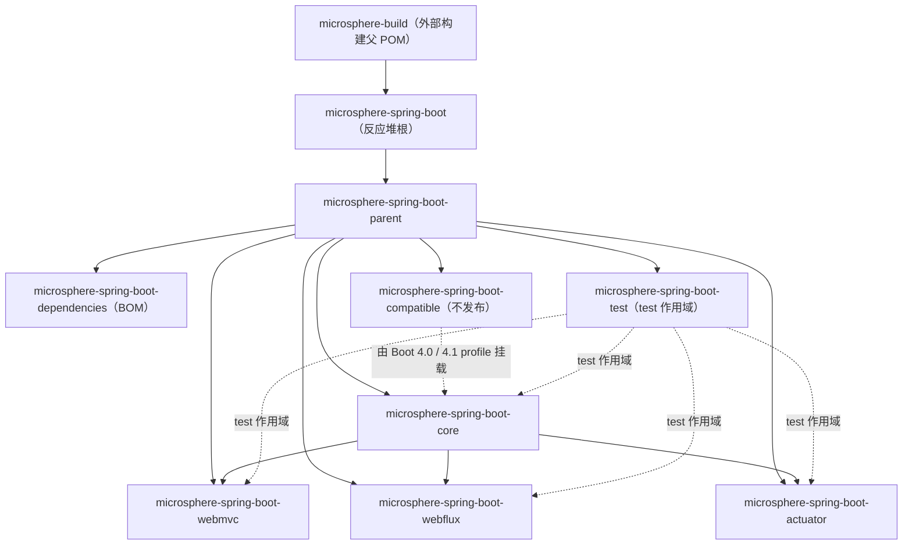

# Microsphere Spring Boot — 文档首页

> [English documentation home](../README.md)

本目录收录 `microsphere-spring-boot` 两条受维护版本线的完整文档，分为**用户文档**（模块做什么、怎么用）与
**开发者文档**（代码如何组织、构建如何运作），两者都按分支目录组织，并提供中英双语。

---

## 1. 文档集

| 文档集 | 目录 | 面向读者 | 内容范围 |
|---|---|---|---|
| 用户文档 | [`user-guide/`](../user-guide/zh/README.md) · [English](../user-guide/README.md) | 应用与库的使用者 | 按模块组织的 API 说明、取自各模块测试用例的可运行代码示例、安装片段、配置属性清单、版本信息与兼容范围 |
| 开发者文档 | [`developer-guide/`](../developer-guide/zh/README.md) · [English](../developer-guide/README.md) | 贡献者与维护者 | 包结构、关键类的源码解析、设计模式、启动与运行路径的 Mermaid 流程图/时序图、构建体系、CI 与发布流水线、维护配方 |

每个文档集内，每个分支一个目录，每个 Maven 模块一个文件，中文文件同名镜像在 `zh/` 子目录中。

---

## 2. 分支与版本线

| 文档目录 | 对应分支 | 版本线 | Spring Boot 范围 | Java | CI 矩阵 | 最新发布版本 |
|---|---|---|---|---|---|---|
| `current/` | `release` | `0.2.x` | `3.0.13` – `3.5.16`、`4.0.8` – `4.1.1`（按 minor 线锁定 patch） | 17+ | JDK `17 / 21 / 25` × 8 个 Boot profile = 24 组 | `0.2.34` |
| `1.x/` | `release-1.x` | `0.1.x` | `2.1.18.RELEASE` – `2.7.18`（按 minor 线锁定 patch） | 8+（CI 从 JDK 8 起） | JDK `8 / 11 / 17 / 21 / 25` × 7 个 Boot profile = 35 组 | `0.1.34` |

各分支入口：

| 分支 | 用户文档 | 开发者文档 |
|---|---|---|
| `release`（0.2.x） | [中文](../user-guide/current/zh/README.md) · [English](../user-guide/current/README.md) | [中文](../developer-guide/current/zh/README.md) · [English](../developer-guide/current/README.md) |
| `release-1.x`（0.1.x） | [中文](../user-guide/1.x/zh/README.md) · [English](../user-guide/1.x/README.md) | [中文](../developer-guide/1.x/zh/README.md) · [English](../developer-guide/1.x/README.md) |

> **范围说明.** 文档只以 `release` 与 `release-1.x` 为基线；`main`、`dev`、`dev-1.x` 属开发分支，随提交变动，不作为文档依据。
> 兼容矩阵取自各分支 `microsphere-spring-boot-parent/pom.xml`（声明支持），实测范围取自各分支
> `.github/workflows/maven-build.yml`。

两条线**不能混用**：没有同时支持 Boot 2 与 Boot 3/4 的产物 —— Servlet 命名空间（`javax` vs `jakarta`）、自动配置注册方式
（`spring.factories` vs `AutoConfiguration.imports`）、`SpringBootVersion` 建模的版本区间都不同。

---

## 3. 模块结构图

反应堆由 8 个 Maven 模块组成。下图为 `release`（0.2.x）分支；`1.x` 分支结构相同，区别在于 `compatible` 由 Boot
`2.1`–`2.3` profile 挂载，而不是 Boot `4.x`。

| 模块 | 是否发布 | 对应文档 |
|---|---|---|
| `microsphere-spring-boot`（反应堆根） | — | 用户文档 [`parent.md`](../user-guide/current/zh/parent.md) · 开发者文档 [`parent.md`](../developer-guide/current/zh/parent.md) |
| `microsphere-spring-boot-parent` | 是（pom） | 同上 |
| `microsphere-spring-boot-dependencies` | 是（BOM） | [`dependencies.md`](../user-guide/current/zh/dependencies.md) |
| `microsphere-spring-boot-core` | 是 | [`core.md`](../user-guide/current/zh/core.md) |
| `microsphere-spring-boot-actuator` | 是 | [`actuator.md`](../user-guide/current/zh/actuator.md) |
| `microsphere-spring-boot-webmvc` | 是 | [`webmvc.md`](../user-guide/current/zh/webmvc.md) |
| `microsphere-spring-boot-webflux` | 是 | [`webflux.md`](../user-guide/current/zh/webflux.md) |
| `microsphere-spring-boot-test` | 是 | [`test.md`](../user-guide/current/zh/test.md) |
| `microsphere-spring-boot-compatible` | **否** | [`compatible.md`](../user-guide/current/zh/compatible.md) |

---

## 4. 从哪里开始

| 我想做什么 | 阅读 |
|---|---|
| 在 Boot 3/4 应用中引入这些库 | [用户文档 · `current` 分支](../user-guide/current/zh/README.md) |
| 在 Boot 2 应用中引入这些库 | [用户文档 · `1.x` 分支](../user-guide/1.x/zh/README.md) |
| 让自己写的库携带可覆盖的默认配置 | [core · 用户文档](../user-guide/current/zh/core.md) |
| 弄清楚有哪些 actuator 端点及其默认策略 | [actuator · 用户文档](../user-guide/current/zh/actuator.md) |
| 了解各监听器在启动时如何被装配 | [core · 开发者文档](../developer-guide/current/zh/core.md) |
| 查看扩展点清单与设计模式 | [开发者文档总览](../developer-guide/current/zh/README.md) |
| 构建、只测某个 Boot profile、或发布版本 | [构建与发布](../developer-guide/current/zh/build-and-release.md) |
| 新增模块或新增一个 Boot 版本 profile | [开发者文档总览的贡献指南一节](../developer-guide/current/zh/README.md) |

---

## 5. 文档约定

| 约定 | 说明 |
|---|---|
| 语言布局 | 英文为默认语言，存放于主路径；中文在平行 `zh/` 目录中按同名文件镜像。每篇文档顶部都有对方语言的链接。 |
| 分支布局 | 每个文档集内：`current/` 对应 `release` 分支（0.2.x），`1.x/` 对应 `release-1.x` 分支（0.1.x）。 |
| 一模块一文档 | 每个 Maven 模块在两个文档集中都各有自己的文档，POM 模块（`parent`、`dependencies`）同样有。 |
| 事实来源 | 类名、方法签名、属性键、默认值、版本号均取自对应分支的源码或 POM，不做推测。 |
| 代码示例 | 尽可能取自模块自身的测试类，示例旁标注来源文件。 |
| 版本标注 | 列出的 Spring Boot 版本是该 minor 线被实际构建与测试锁定的 patch 版本；同线其他 patch 视为可用。 |
| 不发布的模块 | `microsphere-spring-boot-compatible` 永不应作为应用依赖，详见其文档。 |

---

## 6. 相关资源

| 资源 | 链接 |
|---|---|
| 项目 README（main） | [../../README.md](../../README.md) |
| 单文件快速指南（main） | [../../user-guide.md](../../user-guide.md) |
| 发布说明 | [../../release-notes.md](../../release-notes.md) |
| Issue 跟踪 | https://github.com/microsphere-projects/microsphere-spring-boot/issues |
| 自动生成文档 | https://deepwiki.com/microsphere-projects/microsphere-spring-boot · https://zread.ai/microsphere-projects/microsphere-spring-boot |

许可：Apache License 2.0。
